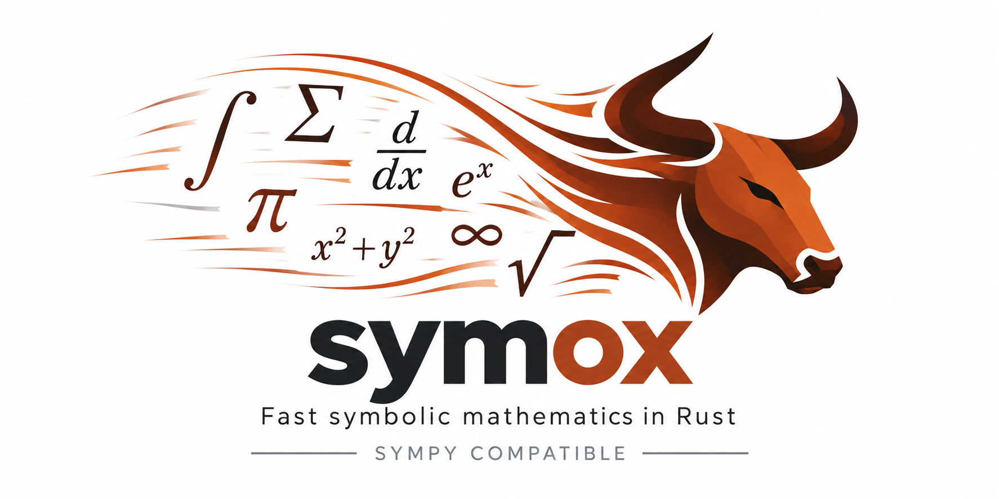

# symox

<p align="center">
  
</p>

**Fast symbolic mathematics in Rust, with a SymPy compatible Python API.**

symox is a computer algebra system written from scratch in Rust, designed as
a **drop-in replacement for SymPy**. It follows SymPy's semantics (canonical
forms, automatic simplifications, printing), while being one to three orders
of magnitude faster on the included benchmarks.

```python
from symox import symbols, sin, cos, exp, expand, diff, lambdify

x, y = symbols("x y")
expand((x + y)**3)            # x**3 + 3*x**2*y + 3*x*y**2 + y**3
diff(sin(x)*exp(x), x)        # exp(x)*sin(x) + exp(x)*cos(x)
(x**2 + y).subs(x, 2)         # y + 4
f = lambdify((x, y), sin(x)*cos(y))   # compiled, vectorised over numpy arrays
```

It is also a plain Rust library:

```rust
use symox::prelude::*;

let x = Expr::symbol("x");
let e = expand(&(&x + 1).powi(10));
println!("{}", diff(&e, &x));
```

## Features

- Native Rust expression DAG, exact arithmetic and arbitrary precision evaluation.
- Polynomials, factorization and Gröbner bases over supported exact domains.
- Symbolic differentiation, integration, solving, series, limits and recurrences.
- Dense, sparse and abstract matrices with exact linear algebra.
- Dense and sparse multidimensional arrays, tensor contractions and finite Jacobians.
- Boolean algebra, SAT, symbolic sets and assumptions.
- Exact Euclidean geometry and scalar/linear-system ODE and first-order PDE interfaces.
- Numerical compilation and code generation for NumPy, C/C++, Rust, Fortran,
  CUDA, PyTorch, JAX, Slang and SYCL.

Supported cases and remaining limitations are detailed in the guides below.

## SymPy API coverage

Measured on 2026-10-18 against SymPy 1.14.0 in the current development tree.

| Surface | Present | Missing | API presence |
|---|---:|---:|---:|
| SymPy top-level exports | 749 / 921 | 172 | 81.32% |
| Expr methods | 97 / 97 | 0 | 100.00% |
| Poly methods | 154 / 154 | 0 | 100.00% |
| Matrix methods | 178 / 178 | 0 | 100.00% |
| MatrixExpr methods | 105 / 105 | 0 | 100.00% |
| AlgebraicNumber methods | 103 / 103 | 0 | 100.00% |
| Rational domain methods | 87 / 87 | 0 | 100.00% |
| Geometry exports | 30 / 30 | 0 | 100.00% |
| Ordinary differential equations exports | 11 / 11 | 0 | 100.00% |
| Partial differential equations exports | 9 / 9 | 0 | 100.00% |
| Equation solvers exports | 7 / 15 | 8 | 46.67% |
| Inequalities exports | 8 / 8 | 0 | 100.00% |
| Arrays exports | 13 / 16 | 3 | 81.25% |
| Indexed tensor algebra exports | 0 / 35 | 35 | 0.00% |
| Series and limits exports | 9 / 18 | 9 | 50.00% |
| Sequences exports | 7 / 10 | 3 | 70.00% |
| Real analysis exports | 8 / 9 | 1 | 88.89% |
| Singularities and monotonicity exports | 6 / 7 | 1 | 85.71% |
| Coefficient domains exports | 20 / 32 | 12 | 62.50% |
| Polynomial ring constructors exports | 0 / 4 | 4 | 0.00% |
| Fraction field constructors exports | 0 / 4 | 4 | 0.00% |
| Number fields exports | 5 / 10 | 5 | 50.00% |
| Combinatorics exports | 2 / 33 | 31 | 6.06% |
| Symbolic sets exports | 19 / 26 | 7 | 73.08% |
| Simplification exports | 28 / 32 | 4 | 87.50% |
| Integral transforms exports | 25 / 26 | 1 | 96.15% |
| Special functions: gamma exports | 7 / 9 | 2 | 77.78% |
| Special functions: hypergeometric exports | 1 / 17 | 16 | 5.88% |
| Special functions: Bessel exports | 12 / 21 | 9 | 57.14% |
| Special functions: Mathieu exports | 0 / 5 | 5 | 0.00% |
| Complex functions and branches exports | 8 / 14 | 6 | 57.14% |
| Number theory exports | 73 / 73 | 0 | 100.00% |
| Iterable utilities exports | 16 / 59 | 43 | 27.12% |
| Printing and code generation exports | 6 / 41 | 35 | 14.63% |
| Plotting exports | 0 / 11 | 11 | 0.00% |

These percentages count available names. They do not verify signatures,
accepted domains or behavior, and there is no combined global parity score.
Module rows measure the corresponding import surface (the complete mapping is
in `tools/sympy_coverage.py`), including absent modules at 0%. A name available
at the package root can still be missing from its compatible module path.
Rows overlap and must not be added together.
Geometry and differential-equation support is scoped in the
[geometry](docs/geometry.md) and [ODE/PDE](docs/differential-equations.md) guides.
In particular, `galois_group` currently supports degrees up to four;
`DomainMatrix` covers implemented exact and numerical domains. See the
[polynomial](docs/polynomials.md) and [matrix](docs/matrices.md) guides for details.

Reproduce the measurement, including missing names and an optional differential corpus:

```bash
python tools/sympy_coverage.py --corpus --json /tmp/symox-coverage.json --update-readme
```

## Building

Use an active Python virtual environment with Rust installed. Python 3.9 or later is required.

```bash
python -m pip install maturin numpy
maturin develop --release
```

See [testing and benchmarks](docs/testing.md) for the Rust and Python test commands.

## Documentation

| Guide | Contents |
|---|---|
| [SymPy compatibility](docs/compatibility.md) | Expressions, precision, assumptions, calculus, logic and sets |
| [Expression method options](docs/expression-methods.md) | Coefficients, replacement rules, structural queries and leading terms |
| [Series and expression analysis](docs/series.md) | Formal/Fourier/asymptotic series, meromorphic tests and branch factors |
| [Sequences](docs/sequences.md) | Formula and periodic sequences, fitted recurrences and generating functions |
| [Finite differences](docs/finite-differences.md) | Exact arbitrary-grid weights and derivative stencils |
| [Real and complex analysis](docs/real-analysis.md) | Singularities, continuity, periods, monotonicity, convexity and extrema |
| [Polynomials and linear systems](docs/polynomials.md) | Domains, factorization, Gröbner bases, roots and Galois groups |
| [Solution checks and linear isolation](docs/solver-checks.md) | Equation validation, pole exclusions and square LU systems |
| [Differential equations](docs/differential-equations.md) | ODE classification, exact equations, linear systems, PDE characteristics and separation |
| [Geometry](docs/geometry.md) | Exact points, linear entities, conics, polygons, planes and intersections |
| [Real inequalities](docs/inequalities.md) | Polynomial sign charts, rational systems and nested absolute values |
| [Coefficient domains](docs/domains.md) | Exact arithmetic, free modules, ideals and quotient rings |
| [Algebraic numbers](docs/algebraic-numbers.md) | Exact field coordinates, structural methods and scalar calculations |
| [Symbolic matrices](docs/matrices.md) | Dense/sparse matrices, matrix expressions and decompositions |
| [Domain matrices](docs/domain-matrices.md) | Typed coefficient arithmetic, elimination, kernels and solving |
| [Matrix expression protocols](docs/matrix-expressions.md) | Structural queries, scalar calculus and matrix coefficient series |
| [Permutation matrices](docs/matrix-permutations.md) | Native permutation nodes, composition and row/column operations |
| [Arrays and tensors](docs/arrays.md) | Multidimensional storage, tensor operations and finite matrix derivatives |
| [Utilities](docs/utilities.md) | Sorting, traversal, containers, graph ordering and memoization |
| [Code generation](docs/codegen/overview.md) | Target overview and execution routes |
| [CUDA](docs/codegen/cuda.md) | NVRTC compilation and native execution |
| [PyTorch](docs/codegen/pytorch.md) | Source export, autograd and optional compilation |
| [JAX](docs/codegen/jax.md) | Source export, autodiff and JIT |
| [Slang](docs/codegen/slang.md) | Shader source and optional SlangPy execution |
| [SYCL / AdaptiveCpp](docs/codegen/sycl.md) | C++ kernels and asynchronous execution |
| [Code generation compatibility](docs/codegen/compatibility.md) | SymPy-style constructors and printer extensions |
| [Testing and coverage](docs/testing.md) | Differential tests, API measurement and fuzzing |
| [Architecture](docs/architecture.md) | Rust modules and expression invariants |

## License

Dual licensed under MIT or Apache-2.0, at your option.
