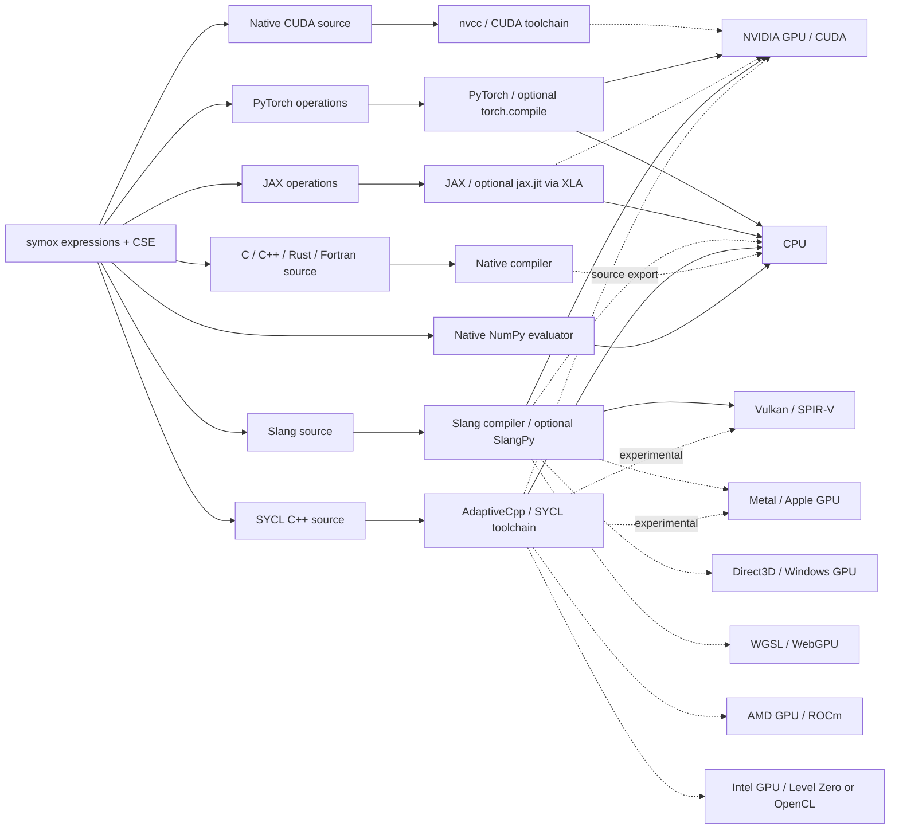

# symox

**Fast symbolic mathematics in Rust, with a SymPy compatible Python API.**

symox is a computer algebra system written from scratch in Rust. It follows
SymPy's semantics (canonical forms, automatic simplifications, printing) so
that existing SymPy code can switch with minimal changes, while being one to
three orders of magnitude faster.

```python
from symox import symbols, sin, cos, exp, expand, diff, lambdify

x, y = symbols("x y")
expand((x + y)**3)            # x**3 + 3*x**2*y + 3*x*y**2 + y**3
diff(sin(x)*exp(x), x)        # exp(x)*sin(x) + exp(x)*cos(x)
(x**2 + y).subs(x, 2)         # y + 4
f = lambdify((x, y), sin(x)*cos(y))   # compiled, vectorised over numpy arrays
```

It is also a plain Rust library:

```rust
use symox::prelude::*;

let x = Expr::symbol("x");
let e = expand(&(&x + 1).powi(10));
println!("{}", diff(&e, &x));
```

## Status

Implemented:

* expression DAG with cached hashes, canonical `Add`/`Mul`/`Pow` following
  SymPy's automatic simplification rules (like-term collection, power
  merging, exact radicals `sqrt(8) = 2*sqrt(2)`, `I**2 = -1`, numeric
  coefficient distribution, infinities and `nan`, ...)
* exact integers (machine word fast path, transparent big integers),
  rationals and floats
* elementary and special functions with automatic evaluation (special values
  of trig functions, parity, periodicity, inverse compositions, ...)
* `diff`, `expand` (sparse polynomial fast path), `subs`, `xreplace`,
  `evalf`, `free_symbols`, `has`, relationals, `Piecewise`
* `str`/`srepr` printers matching SymPy, a parser (`sympify`) accepting
  SymPy's `str` and `srepr` output
* `lambdify`: compiles expressions into a register machine with common
  subexpression sharing, vectorised over NumPy arrays (GIL released)
* Python bindings (PyO3, abi3 wheels for CPython >= 3.9), conversion to and
  from SymPy objects
* polynomials over integer, rational and finite-field domains: `Poly`,
  factorization, GCD, cancellation, partial fractions, roots and division
* symbolic assumptions, simplification, integration, summation, equation and
  ODE solving, series and limits
* mutable and immutable symbolic matrices, exact linear algebra and supported
  eigenproblems
* Boolean algebra, normal forms, truth-table minimization, SAT, symbolic sets
  and supported set-based equation solving
* LaTeX and pretty printing, common subexpression elimination, native code
  printers and extensible C++17 generation
* optional PyTorch and JAX code generation, standalone source export, automatic
  differentiation and opt-in compilation with `torch.compile` / `jax.jit`
* portable Slang source and optional SlangPy execution; standard SYCL C++ source
  and asynchronous kernels for AdaptiveCpp
* isolated differential fuzzing, seeded replay, shrinking and triage

The sections below describe the supported subsets and remaining limitations.

Special functions include combinatorial numbers, gamma/zeta families, error
and exponential integrals, Bessel/Airy functions, elliptic integrals, Lambert W,
hypergeometric functions and orthogonal polynomials, with symbolic evaluation,
derivatives and double precision real/complex numerics. `expand_func`,
`besselsimp`, `hyperexpand`, Stirling numbers and multinomial coefficients are
also available. Unsupported symbolic cases remain unevaluated.

`special_nstr(expr, dps)` returns an arbitrary precision decimal string for
numeric expressions supported by the multiprecision evaluator, including
factorial, binomial, rising/falling factorials, beta, Catalan, Fibonacci and
Lucas via exact gamma/elementary identities. Other special function families
return `None` when multiprecision evaluation is unsupported; no double
precision fallback is presented as extra significant digits. The regular
`N`/`evalf` expression API still uses double precision.

## Compatibility with SymPy

`tests/compare_sympy.py` runs every case through SymPy and symox and
compares the printed canonical forms and, when they differ, numerical
equivalence. Known deliberate deviations:

* `diff(Abs(x), x)` returns `sign(x)` (the real-variable formula).
* `evalf` is double precision for now (`n` is accepted but ignored).
* Some antiderivatives use a different branch constant from SymPy (for example
  `integrate(exp(-x)/x, x)` returns `Ei(-x)`).

## Building

```bash
cargo test                      # Rust core
pip install maturin
maturin develop --release       # Python package into the active venv
python tests/compare_sympy.py   # differential tests (needs sympy)
python benches/bench_vs_sympy.py
```

## Code generation targets

The same expression tree can feed several execution paths. In particular,
CUDA is reachable through native CUDA source, PyTorch, JAX, Slang or SYCL:



Solid device edges are exercised by this project's numerical execution tests.
Dotted edges show external toolchain routes not
validated here; they are not guarantees of feature or precision parity.
JAX is tested on CPU here; its CUDA route requires a suitable JAX installation.
Native source exports need their corresponding compiler and host integration.
SlangPy's CPU dispatch is not enabled by our adapter. AdaptiveCpp's tested
configuration is the CPU OpenMP backend; GPU execution needs a compiler/runtime
installation with those backends enabled. The diagram does not imply that
symox chooses a backend automatically or that every route has the same speed.

Framework functions preserve autograd where supported; Slang and SYCL exports
are ordinary direct numerical kernels and require no differentiation framework.

## PyTorch code generation

Install `symox[torch]`, or install the PyTorch build appropriate for your GPU
separately. Importing symox does not import PyTorch. The PyTorch backend builds
tensor operations from the native expression tree without a SymPy dependency:

```python
import torch
import symox as sm

x, y = sm.symbols("x y")
expression = sm.Matrix([[sm.sin(x*y)], [sm.sqrt(1 + x*x + y*y)]])
f = sm.lambdify((x, y), expression, "torch")
xv = torch.linspace(0, 1, 1024, requires_grad=True)
result = f(xv, 0.3)                      # shape: (1024, 2, 1)
result.sum().backward()

compiled = sm.torch_lambdify(
    (x, y), expression, compile=True,
    compile_options={"fullgraph": True},  # default backend: Inductor
)
result = compiled(xv, 0.3)
```

Tensor inputs determine the device and promoted dtype. Python scalar inputs
use PyTorch's default floating dtype when no tensor is supplied. Every call
also accepts `dtype=` and `device=`. Scalar outputs broadcast to the common
input shape. Lists and tuples retain their structure; symbolic matrices and
NumPy arrays become tensors with batch dimensions followed by expression
dimensions. Boolean outputs retain boolean dtype, and complex values remain
complex. Existing input tensors stay connected to autograd.

`torchcode_function("my_function", (x, y), expression)` returns a complete
Python module that needs only PyTorch at runtime. Generated callables expose
the full module through `__source__`; `inspect.getsource` retrieves the function
definition. `torchcode` and
`symox.printing.pytorch.PyTorchPrinter` provide lower-level expression printing;
these expression snippets use the `_sx_tensor` helper included in exported
modules. Custom functions can be supplied through `user_functions`; source
export requires qualified import paths, whereas `torch_lambdify` also accepts
callables.

CSE shares work across outputs. For `Piecewise`, CSE is currently disabled to
keep expressions inside their branch masks. The printer neutralizes inactive
arguments of supported operations before evaluating branches, including
division, square roots and logarithms, so invalid inactive branches do not
poison gradients. Custom function mappings are responsible for their own
domains and autograd behavior. Unsupported symbolic functions fail during
generation instead of silently switching numerical backends.

Compilation is optional and its errors are propagated. The first call includes
tracing and compilation; shape, dtype or device changes may cause recompilation.
Use `compile_options` to pass PyTorch options such as `backend`, `dynamic`,
`fullgraph` or `mode`. Performance depends on workload and batch size: measure
warm execution separately from compilation, for example:

```bash
python benches/bench_pytorch.py --help
```

See PyTorch's [compilation documentation](https://docs.pytorch.org/docs/stable/generated/torch.compile.html)
and [autograd explanation of invalid operations](https://docs.pytorch.org/docs/stable/notes/autograd.html#division-by-zero-in-autograd).

For an indicative local measurement, the benchmark's default refraction kernel
with 65,536 float32 rays on an RTX 5090 took 0.549 ms in eager mode and 0.098 ms
with Inductor after compilation (5.6x). With gradients, it took 1.961 ms versus
0.552 ms (3.6x). The first compiled call took 2.4–4.2 seconds, excluding wrapper
setup. These are local measurements with PyTorch 2.11, not performance guarantees.

## JAX code generation

Install `symox[jax]` for the CPU backend, or install a suitable JAX accelerator
build separately. JAX also stays optional and is not imported by `import symox`.
The API uses the same input/output structure and native traversal as PyTorch:

```python
import jax
import jax.numpy as jnp
import symox as sm

x, y = sm.symbols("x y")
expr = sm.sin(x*y) + sm.sqrt(1 + x*x)
f = sm.lambdify((x, y), expr, "jax", jit=True)
values = f(jnp.linspace(0, 1, 1024), 0.3)
gradient = jax.grad(f, argnums=0)(0.2, 0.3)
batched = jax.vmap(f, in_axes=(0, None))(jnp.linspace(0, 1, 1024), 0.3)
```

`jax_lambdify` accepts `cse`, `user_functions`, `jit` and `jit_options`.
`jaxcode_function` exports a module importing only JAX; `jaxcode` and
`symox.printing.jax.JaxPrinter` expose expression printing. Generated functions
accept `dtype=` and `device=` (a JAX Device or a backend name such as `"cpu"`);
these keywords are static when JIT is enabled. Dtypes obey JAX's configuration,
including its default disabling of 64-bit arithmetic. No global configuration
is changed. `Piecewise` uses the same masking precautions as PyTorch, with CSE
disabled for conditional graphs. Use `block_until_ready` when timing JAX work.
`python benches/bench_jax.py --help` describes the reproducible JAX benchmark,
with compilation time and warm execution reported separately.

Both backends support elementary functions, relations, Boolean operations and
selected special functions. In particular, `loggamma` requires a provably
positive argument: the real `lgamma`/`gammaln` operations do not implement
SymPy's complex branches. Unsupported special functions raise
`NotImplementedError`. These backends extend the supported SymPy surface;
symox does not yet implement all of SymPy.

See JAX's [JIT documentation](https://docs.jax.dev/en/latest/jit-compilation.html)
and [FAQ on gradients through `where`](https://docs.jax.dev/en/latest/faq.html#gradients-contain-nan-where-using-where).

## Slang code generation

`slangcode` and the extensible `SlangCodePrinter` print real scalar expressions.
`slangcode_function` exports a complete Slang function with shared CSE. Scalar
results return directly; lists, tuples, matrices and arrays return a generated
struct whose `_sx_o_0`, `_sx_o_1`, ... fields follow depth-first row-major order.
Source export requires neither SlangPy nor a GPU:

```python
import symox as sm

x, y = sm.symbols("x y")
expr = sm.Matrix([[sm.sin(x*y)], [sm.sqrt(1+x*x+y*y)]])
source = sm.slangcode_function("evaluate", (x, y), expr, dtype="float32")
```

For optional Python execution, install `symox[slang]`. SlangPy compiles and
vectorizes the scalar function for the chosen backend; no Torch or JAX runtime
is needed. CUDA and Vulkan are exercised by numerical tests, including software
Vulkan in CI. Other backend selections depend on the external runtime and device.

```python
import numpy as np
import slangpy as spy

device = spy.create_device(type=spy.DeviceType.cuda)  # or DeviceType.vulkan
f = sm.lambdify((x, y), expr, "slang", device=device)
inputs = spy.Tensor.from_numpy(device, np.linspace(0, 1, 1024, dtype=np.float32))
result = f(inputs, 0.3)       # GPU Tensor, shape (1024, 2, 1)
host_result = result.to_numpy()
f(inputs, 0.3, out=result)   # reuse the output allocation
```

Existing SlangPy tensors stay on device. NumPy inputs are uploaded; request
`return_type="numpy"` at construction for explicit host results. Lists and tuples
retain their structure, matrices and arrays have trailing expression dimensions,
and boolean outputs retain their logical type. `out=` reuses supplied tensors;
`_append_to=` records into a SlangPy command encoder for deferred submission.
Deferred execution cannot be combined with automatic NumPy output.

`slang_kernel` additionally exports an explicit `name_kernel` compute entry with
`StructuredBuffer` inputs, writable output buffers and a count. This lower-level
ABI uses equally sized contiguous scalar batches, one output buffer per expression
leaf; boolean outputs use uint32 values 0/1. The host controls allocation and
dispatch. SlangPy's higher-level adapter handles broadcasting and tensor strides.

The portable baseline is float32. Float64 source uses double literals and depends
on target capabilities; the Python adapter currently permits float64 execution
only with CUDA. CPU dispatch is not exposed by this adapter. Complex expressions
and unsupported special functions fail explicitly. CSE is disabled around
`Piecewise` graphs to keep inactive branches inside scalar short-circuit conditions.
Custom `user_functions` mappings name functions supplied by the surrounding Slang
module. Automatic differentiation is not part of this backend.

`python benches/bench_slang.py --help` describes the synchronized optical
benchmark, with source generation, module loading, first dispatch and warm
execution separated. It optionally compares against `torch.compile`. For one
local 65,536-ray float32 run, Slang CUDA took about 0.113 ms versus 0.095 ms for
Inductor; Slang is not assumed to outperform the framework compiler. Software
Vulkan inverse trigonometric builtins can also have lower numerical accuracy
than the tested NVIDIA implementation.

See the [Slang targets](https://docs.shader-slang.org/en/stable/external/slang/docs/user-guide/09-targets.html)
and [SlangPy vectorization](https://slangpy.shader-slang.org/en/latest/src/basics/firstfunctions.html)
documentation for external runtime details.

## SYCL and AdaptiveCpp code generation

`syclcode` / `SYCLCodePrinter` print standard SYCL 2020 math in C++17.
`syclcode_function` exports an inline scalar function, using the same flattened
result-struct convention as Slang. `sycl_kernel` exports a scalar `name_eval`
function and an asynchronous `name` launcher:

```python
source = sm.sycl_kernel("evaluate", (x, y), expr, dtype="float64")
with open("evaluate.hpp", "w") as generated:
    generated.write(source)
```

The launcher takes a `sycl::queue&`, element count, one constant USM input pointer
per argument, one writable USM output pointer per expression leaf, and optional
event dependencies. It returns a `sycl::event`, performs no allocation or wait,
and preserves dependencies for zero-length batches. The caller supplies valid
USM allocations with equal-length contiguous batches and owns their lifetime.
Float64 is the default; launchers check `sycl::aspect::fp64` before execution.
Boolean outputs use `bool*`. `adaptivecppcode`, `AdaptiveCppCodePrinter`,
`adaptivecppcode_function` and `adaptivecpp_kernel` are aliases of the SYCL API.

An application including the generated header can be compiled with a configured
AdaptiveCpp installation, for example:

```bash
acpp --acpp-targets=generic -std=c++17 -O3 application.cpp -o application
```

No AdaptiveCpp SDK is needed for source generation. Numerical tests compile and
execute the generated functions and USM kernels using AdaptiveCpp's OpenMP CPU
backend. This validates generated code and asynchronous dependencies; it does not
validate AdaptiveCpp GPU execution or its generic JIT configuration. A full SDK
and appropriate drivers are needed for those routes. To run SDK integration tests:

```bash
SYMOX_ACPP=/path/to/acpp SYMOX_ACPP_TARGETS=omp python -m pytest tests/test_sycl_codegen.py
```

See AdaptiveCpp's [compilation model](https://adaptivecpp.github.io/AdaptiveCpp/compilation/)
and [installation instructions](https://github.com/AdaptiveCpp/AdaptiveCpp/blob/develop/doc/installing.md).

## Symbolic matrices

`Matrix` provides mutable dense matrices; `ImmutableMatrix` and
`ImmutableDenseMatrix` provide immutable, hashable matrices. Constructors
accept nested sequences, NumPy arrays, SymPy matrices and nested matrix
blocks. Arithmetic, slicing, entry transformations, symbolic derivatives,
Jacobian/Hessian construction, exact determinant/inverse, row reduction,
linear solves, characteristic polynomials and supported eigenproblems run
in Rust. Cholesky, LDL, QR and diagonalization are also available.

```python
from symox import Matrix, ImmutableMatrix, symbols

x = symbols("x")
a = Matrix([[x, 1], [1, x]])
a.det()                          # x**2 - 1
a.inv()
a.gauss_jordan_solve(Matrix([1, 2]), freevar=True)
ImmutableMatrix(a)               # rejects mutation; usable as a dictionary key
```

`dot` supports Hermitian conjugation conventions; `diagonalize` supports
`reals_only`, `sort` and `normalize`. Matrix pickles preserve entry
assumptions and unevaluated arithmetic. Immutable results preserve their
immutability through arithmetic, slicing and decompositions; `as_mutable()`
returns an independent editable copy.

This API does not cover every SymPy matrix method. Eigenproblems beyond the
supported exact algebraic cases, custom zero/simplification callbacks and
unsupported constructor/algorithm options raise `NotImplementedError`.
Matrix `evalf` currently supports its default 15-digit double precision;
other precision requests raise `NotImplementedError`. Vector norms and
matrix Frobenius/1/infinity norms are supported; matrix spectral norms
are not implemented.

```bash
python tests/compare_matrices.py
python -m pytest tests/test_matrix_compat.py tests/compare_matrices.py
```

## Symbolic code generation compatibility

For the scalar polynomial API used by TriSplyne, replace imports consistently:

```python
import symox as sm
from symox.printing.cxx import CXX17CodePrinter
from symox.printing.precedence import precedence, PRECEDENCE
from symox.codegen.ast import Assignment, CodeBlock, Comment
```

`Add`, `Mul`, `Pow`, `Symbol`, `Integer`, `Rational`, `Float`, and
`UnevaluatedExpr` provide constructors and `isinstance` checks for native Rust
expressions. `S.Half`, tree reconstruction through `expr.func(*expr.args)`,
coefficient extraction, operation counts, deterministic `default_sort_key`,
NumPy object arrays, and expression pickling are supported. Free symbol
discovery is cached on immutable expression nodes; callers receive independent
Python sets.

`UnevaluatedExpr` and `Mul(..., evaluate=False)` preserve coefficients and
grouping for Horner code generation. `subs` supports algebraic sum and product
patterns; `xreplace` performs exact replacement. `reduced(f, divisors, *gens)`
returns polynomial quotients and a remainder, with deterministic generator
ordering when generators are inferred. Reduction currently supports `order="lex"`;
explicit `domain`/`modulus`, `polys=True`, and `auto=False` raise
`NotImplementedError`.

The extensible Python `CXX17CodePrinter` supports `_print_<Class>` overrides,
`doprint`, and `parenthesize`. The existing top-level `cxxcode` uses the native
Rust printer. `StrPrinter` and `PrettyPrinter` are available for debug output.
This compatibility surface targets scalar polynomial workflows; it is not a
replacement for every SymPy module.

Consumer integration tests load the real TriSplyne modules with each backend
and compare generated text. They need a sibling checkout or an explicit path:

```bash
TRISPLYNE_PATH=/path/to/trisplyne python -m pytest tests/test_trisplyne_integration.py
```

## Boolean logic and sets

`And`, `Or`, `Not`, `Xor`, `Implies`, `Equivalent`, `ITE`, CNF/DNF/NNF
conversion, `SOPform`, `POSform`, `simplify_logic`, truth tables and a native
SAT solver are available. Set operations include intervals, finite sets,
unions, intersections, complements, products, image sets, condition sets,
ranges and the standard named sets through `S`. `solveset` handles polynomial
and supported periodic equations; unresolved equations remain `ConditionSet`s.
Periodic solutions exclude denominator poles.

The SAT solver uses propositional atoms. `use_lra_theory=True`, `minimal=True`
and external solver selections raise `NotImplementedError`. Dense truth-table
operations support at most 20 variables; ordinary SAT solving has no such
limit. `simplify_logic(..., dontcare=...)` is not yet supported (the separate
`SOPform` and `POSform` functions accept don't-care rows). Inequality solving
supports one variable. Other unresolved membership queries remain symbolic.

## Differential fuzzing

The fuzzer builds the same seeded expression trees through both APIs. Each
native worker is isolated in a subprocess and restarted after a crash or case
timeout. A wall-clock budget also cancels shrinking; `--jobs` controls the
number of independent workers. Findings are shrunk and deduplicated into
`findings.jsonl`, with run counts in `stats.json`.

```bash
python tests/fuzz/fuzz_core.py --mode core --seeds 0:100 --jobs 2 --time 60
python tests/fuzz/fuzz_core.py --replay core 7 srepr --timeout 5
python tests/fuzz/triage.py tests/fuzz/out/findings.jsonl wrong,crash,died
```

Modes also cover integration, solving, series, limits, summation,
simplification, lambdify, and parsing (`--mode all` runs all modes). Findings
distinguish numerical errors, canonical-form differences, unsupported results,
crashes, timeouts, and slow calls. Runs report findings without failing by
default; use `--fail-on wrong,crash,died` for an explicit CI failure policy.
Replay uses the same process isolation and timeout as a normal run.

## Architecture

| module | content |
|---|---|
| `number.rs` | `Number`: `i64` / big integer / rational / `f64` |
| `expr.rs` | `Expr` (Arc'd node with cached hash and symbol bloom mask), `Kind` |
| `ops.rs` | canonical constructors `add`, `mul`, `pow`, operators |
| `functions.rs` | function heads and their automatic evaluation |
| `diff.rs`, `expand.rs`, `subs.rs`, `evalf.rs` | core algorithms |
| `printer.rs`, `parser.rs` | `str`/`srepr` and `sympify` |
| `lambdify.rs` | numerical compilation |
| `poly/` | exact polynomial arithmetic, factoring and rational functions |
| `matrix/` | symbolic and exact matrix algorithms |
| `logic/`, `sets/` | Boolean algebra, SAT, set operations and solving |
| `special/` | special functions and numerical evaluation |
| `crates/symox-py` | Python bindings, `python/symox` the Python package |

Invariants: ordinary `Expr` nodes are canonical. Only `ops`/`functions`
constructors create canonical nodes (`Expr::from_kind` is reserved for code
that guarantees the canonical form itself). The Python `evaluate=False`
constructors explicitly mark held nodes with `Expr::from_unevaluated_kind`.
`Add` stores `(term, coefficient)` pairs, `Mul`
stores `(base, exponent)` pairs, both sorted by `Expr`'s `Ord` (`Mul`
factors by base then exponent).

## License

Dual licensed under MIT or Apache-2.0, at your option.
