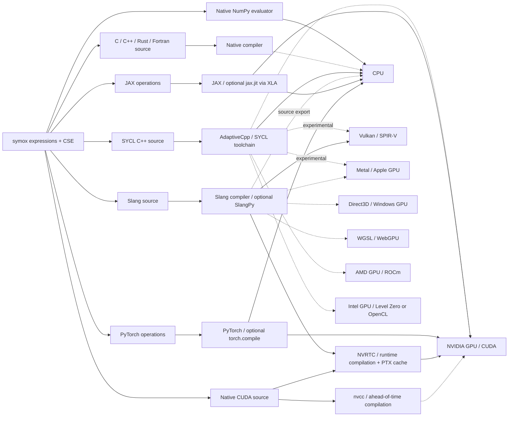

# symox

<p align="center">
  
</p>

**Fast symbolic mathematics in Rust, with a SymPy compatible Python API.**

symox is a computer algebra system written from scratch in Rust, designed as
a **drop-in replacement for SymPy**. It follows SymPy's semantics (canonical
forms, automatic simplifications, printing), while being one to three orders
of magnitude faster on the included benchmarks.

```python
from symox import symbols, sin, cos, exp, expand, diff, lambdify

x, y = symbols("x y")
expand((x + y)**3)            # x**3 + 3*x**2*y + 3*x*y**2 + y**3
diff(sin(x)*exp(x), x)        # exp(x)*sin(x) + exp(x)*cos(x)
(x**2 + y).subs(x, 2)         # y + 4
f = lambdify((x, y), sin(x)*cos(y))   # compiled, vectorised over numpy arrays
```

It is also a plain Rust library:

```rust
use symox::prelude::*;

let x = Expr::symbol("x");
let e = expand(&(&x + 1).powi(10));
println!("{}", diff(&e, &x));
```

## Status

Implemented:

* expression DAG with cached hashes, canonical `Add`/`Mul`/`Pow` following
  SymPy's automatic simplification rules (like-term collection, power
  merging, exact radicals `sqrt(8) = 2*sqrt(2)`, `I**2 = -1`, numeric
  coefficient distribution, infinities and `nan`, ...)
* exact integers (machine word fast path, transparent big integers),
  rationals, machine floats and arbitrary-precision floating-point expressions
* elementary and special functions with automatic evaluation (special values
  of trig functions, parity, periodicity, inverse compositions, ...)
* `diff`, `expand` (sparse polynomial fast path), `subs`, `xreplace`,
  `evalf`, `free_symbols`, `has`, relationals, `Piecewise`
* `str`/`srepr` printers matching SymPy, a parser (`sympify`) accepting
  SymPy's `str` and `srepr` output
* `lambdify`: compiles expressions into a register machine with common
  subexpression sharing, vectorised over NumPy arrays (GIL released)
* Python bindings (PyO3, abi3 wheels for CPython >= 3.9), conversion to and
  from SymPy objects
* polynomials over integer, rational, finite-field, rational-function and
  supported algebraic domains: `Poly`,
  factorization, GCD, cancellation, partial fractions, roots, division and
  reduced Gröbner bases
* symbolic assumptions, simplification, integration, summation, equation and
  ODE solving, series and limits
* mutable, immutable and sparse matrices, abstract matrix expressions,
  exact linear algebra and supported eigenproblems
* Boolean algebra, normal forms, truth-table minimization, SAT, symbolic sets
  and supported set-based equation solving
* LaTeX and pretty printing, common subexpression elimination, native code
  printers and extensible C++17 generation
* optional PyTorch and JAX code generation, standalone source export, automatic
  differentiation and opt-in compilation with `torch.compile` / `jax.jit`
* portable Slang source and optional SlangPy execution; standard SYCL C++ source
  and asynchronous kernels for AdaptiveCpp
* isolated differential fuzzing, seeded replay, shrinking and triage

The sections below describe the supported subsets and remaining limitations.

Special functions include combinatorial numbers, gamma/zeta families, error
and exponential integrals, Bessel/Airy functions, elliptic integrals, Lambert W,
hypergeometric functions and orthogonal polynomials, with symbolic evaluation,
derivatives and double precision real/complex numerics. `expand_func`,
`besselsimp`, `hyperexpand`, Stirling numbers and multinomial coefficients are
also available. Unsupported symbolic cases remain unevaluated.

`Float(value, digits)`, `expr.evalf(digits)` and `N(expr, digits)` preserve
arbitrary precision in native expression nodes, including arithmetic, partial
symbolic evaluation, matrices, parsing, pickling and SymPy interchange.
Decimal strings are parsed directly; Python floats retain their original
binary value. The native multiprecision evaluator supports elementary
real/complex functions and a subset of special functions. Unsupported functions
remain symbolic; they do not receive invented digits from a double fallback.
The current resource limits are 10,000 decimal digits or 40,000 precision bits.
Exponential and hyperbolic evaluation is limited to a real argument magnitude
of 2,000,000; power results are limited to a decimal exponent magnitude around
1,000,000. Outside supported ranges expressions remain symbolic.
Compiled numerical backends still use their declared machine dtypes.

`special_nstr(expr, dps)` returns an arbitrary precision decimal string for
numeric expressions supported by the multiprecision evaluator, including
factorial, binomial, rising/falling factorials, beta, Catalan, Fibonacci and
Lucas via exact gamma/elementary identities. Other special function families
return `None` when multiprecision evaluation is unsupported; no double
precision fallback is presented as extra significant digits.

## Compatibility with SymPy

Assumptions distinguish real `nonzero=True` from complex `zero=False`, and
exact rational-power and supported quadratic facts filter solver candidates
without floating-point tolerances. Unquoted Unicode symbol names are accepted.
Numeric expressions follow Python's hash contract for equal built-in numbers
and `fractions.Fraction` values, so mixed dictionaries and sets work correctly.
`as_coeff_add`, `as_coeff_mul`, `as_independent` and `as_content_primitive`
provide structural decompositions, including dependency selection and rational
or supported radical content. Floating-point presence and maximum precision
are cached per node, so repeated inspection preserves shared expression graphs
instead of traversing every occurrence again.
Undefined functions preserve their identity and declared assumptions and arity,
including names shared with builtins. Held `Derivative`, `Subs` and `Limit` expressions
support evaluation and round trips; simultaneous symbol substitutions preserve
the original right-hand sides. Limits of unknown functions remain held when
continuity cannot be established.
`Subs` accepts symbol variables and identifies safe renamings of bound variables
when substitution points do not refer to those variables. Cases with such
references retain structural identity to preserve their evaluation semantics.
Simultaneous substitutions with non-symbol keys are rejected explicitly.

`tests/compare_sympy.py` runs every case through SymPy and symox and
compares the printed canonical forms and, when they differ, numerical
equivalence. Known deliberate deviations:

* `diff(Abs(x), x)` returns `sign(x)` (the real-variable formula).
* Some antiderivatives use a different branch constant from SymPy (for example
  `integrate(exp(-x)/x, x)` returns `Ei(-x)`).

## Building

```bash
cargo test                      # Rust core
pip install maturin
maturin develop --release       # Python package into the active venv
python tests/compare_sympy.py   # differential tests (needs sympy)
python benches/bench_vs_sympy.py
```

## Code generation targets

**symox aims to be the most complete symbolic engine for code generation across
heterogeneous targets.** One symbolic model feeds native code and array frameworks
across CPUs and GPUs. CUDA alone is reachable through native CUDA source compiled
with nvcc or NVRTC, PyTorch, JAX, Slang and SYCL:



Solid device edges are exercised by this project's numerical execution tests.
Dotted edges show external toolchain routes not
validated here; they are not guarantees of feature or precision parity.
JAX is tested on CPU and NVIDIA CUDA; GPU execution requires a suitable
JAX installation. Explicit JIT devices select the compiled executable's
placement, including when its inputs are Python scalars.
Native source exports need their corresponding compiler and host integration.
Native CUDA source can be compiled ahead of time with nvcc or at runtime with
NVRTC. `cuda_lambdify` supplies native NVRTC compilation and execution; raw
source exports can also be integrated by the caller. NVRTC is also used by
the SlangPy CUDA execution path.
SlangPy's CPU dispatch is not enabled by our adapter. AdaptiveCpp's tested
configuration is the CPU OpenMP backend; GPU execution needs a compiler/runtime
installation with those backends enabled. The diagram does not imply that
symox chooses a backend automatically or that every route has the same speed.

Framework functions preserve autograd where supported; Slang and SYCL exports
are ordinary direct numerical kernels and require no differentiation framework.

## Native CUDA execution with NVRTC

`cuda_lambdify` compiles native CUDA source and executes it through the CUDA
Driver API. It requires the NVIDIA driver and NVRTC shared libraries, with no
PyTorch, JAX, CuPy or CUDA Python package dependency. Library loading is lazy.

```python
import numpy as np
import symox as sm

x, y = sm.symbols("x y")
f = sm.cuda_lambdify((x, y), sm.sin(x) + y, dtype="float64")
result = f(np.arange(3.0)[:, None], np.arange(2.0))  # shape (3, 2)
f.close()
```

Host arrays broadcast and may be noncontiguous. Lists/tuples retain structure;
matrix and array dimensions follow broadcast batch dimensions. Results are
NumPy arrays, with synchronous transfers to and from the GPU. Boolean outputs,
float32/float64, safely renamed arguments, CSE and lazy Piecewise branches are
supported. Complex-valued expressions are not supported by this interface.
`lambdify(..., "cuda")` and `lambdify(..., "nvrtc")` use the same path.

`compile_cuda(source, name)` loads an `extern "C"` kernel for direct use with
device pointers and streams. Its `CudaKernel.launch` method accepts explicitly
typed ctypes arguments; callers own their buffers and asynchronous lifetimes.
Buffers and streams must belong to the selected device's primary CUDA context.
Raw launches are asynchronous; `synchronize()` and `close()` wait for that
primary context. Kernels support context managers. PTX is cached atomically under
`$XDG_CACHE_HOME/symox/nvrtc` (or `~/.cache/symox/nvrtc`), keyed by source,
compiler flags, NVRTC version and GPU architecture. Set `cache_dir=False` to
disable disk caching. Compilation errors include the NVRTC log.

`SYMOX_CUDA_LIBRARY` and `SYMOX_NVRTC_LIBRARY` can select library paths.
Run GPU integration tests with
`SYMOX_CUDA_REQUIRE_RUNTIME=1 python -m pytest tests/test_cuda_runtime.py`.
See the [NVRTC documentation](https://docs.nvidia.com/cuda/nvrtc/).

## PyTorch code generation

Install `symox[torch]`, or install the PyTorch build appropriate for your GPU
separately. Importing symox does not import PyTorch. The PyTorch backend builds
tensor operations from the native expression tree without a SymPy dependency:

```python
import torch
import symox as sm

x, y = sm.symbols("x y")
expression = sm.Matrix([[sm.sin(x*y)], [sm.sqrt(1 + x*x + y*y)]])
f = sm.lambdify((x, y), expression, "torch")
xv = torch.linspace(0, 1, 1024, requires_grad=True)
result = f(xv, 0.3)                      # shape: (1024, 2, 1)
result.sum().backward()

compiled = sm.torch_lambdify(
    (x, y), expression, compile=True,
    compile_options={"fullgraph": True},  # default backend: Inductor
)
result = compiled(xv, 0.3)
```

Tensor inputs determine the device and promoted dtype. Python scalar inputs
use PyTorch's default floating dtype when no tensor is supplied. Every call
also accepts `dtype=` and `device=`. Scalar outputs broadcast to the common
input shape. Lists and tuples retain their structure; symbolic matrices and
NumPy arrays become tensors with batch dimensions followed by expression
dimensions. Boolean outputs retain boolean dtype, and complex values remain
complex. Existing input tensors stay connected to autograd.

`torchcode_function("my_function", (x, y), expression)` returns a complete
Python module that needs only PyTorch at runtime. Generated callables expose
the full module through `__source__`; `inspect.getsource` retrieves the function
definition. `torchcode` and
`symox.printing.pytorch.PyTorchPrinter` provide lower-level expression printing;
these expression snippets use the `_sx_tensor` helper included in exported
modules. Custom functions can be supplied through `user_functions`; source
export requires qualified import paths, whereas `torch_lambdify` also accepts
callables.

CSE shares work across outputs. For `Piecewise`, CSE is currently disabled to
keep expressions inside their branch masks. The printer neutralizes inactive
arguments of supported operations before evaluating branches, including
division, square roots and logarithms, so invalid inactive branches do not
poison gradients. Custom function mappings are responsible for their own
domains and autograd behavior. Unsupported symbolic functions fail during
generation instead of silently switching numerical backends.

Compilation is optional and its errors are propagated. The first call includes
tracing and compilation; shape, dtype or device changes may cause recompilation.
Use `compile_options` to pass PyTorch options such as `backend`, `dynamic`,
`fullgraph` or `mode`. Performance depends on workload and batch size: measure
warm execution separately from compilation, for example:

```bash
python benches/bench_pytorch.py --help
```

See PyTorch's [compilation documentation](https://docs.pytorch.org/docs/stable/generated/torch.compile.html)
and [autograd explanation of invalid operations](https://docs.pytorch.org/docs/stable/notes/autograd.html#division-by-zero-in-autograd).

For an indicative local measurement, the benchmark's default refraction kernel
with 65,536 float32 rays on an RTX 5090 took 0.549 ms in eager mode and 0.098 ms
with Inductor after compilation (5.6x). With gradients, it took 1.961 ms versus
0.552 ms (3.6x). The first compiled call took 2.4–4.2 seconds, excluding wrapper
setup. These are local measurements with PyTorch 2.11, not performance guarantees.

## JAX code generation

Install `symox[jax]` for the CPU backend, or install a suitable JAX accelerator
build separately. JAX also stays optional and is not imported by `import symox`.
The API uses the same input/output structure and native traversal as PyTorch:

```python
import jax
import jax.numpy as jnp
import symox as sm

x, y = sm.symbols("x y")
expr = sm.sin(x*y) + sm.sqrt(1 + x*x)
f = sm.lambdify((x, y), expr, "jax", jit=True)
values = f(jnp.linspace(0, 1, 1024), 0.3)
gradient = jax.grad(f, argnums=0)(0.2, 0.3)
batched = jax.vmap(f, in_axes=(0, None))(jnp.linspace(0, 1, 1024), 0.3)
```

`jax_lambdify` accepts `cse`, `user_functions`, `jit` and `jit_options`.
`jaxcode_function` exports a module importing only JAX; `jaxcode` and
`symox.printing.jax.JaxPrinter` expose expression printing. Generated functions
accept `dtype=` and `device=` (a JAX Device or a backend name such as `"cpu"`);
these keywords are static when JIT is enabled. Dtypes obey JAX's configuration,
including its default disabling of 64-bit arithmetic. No global configuration
is changed. `Piecewise` uses the same masking precautions as PyTorch, with CSE
disabled for conditional graphs. Use `block_until_ready` when timing JAX work.
`python benches/bench_jax.py --help` describes the reproducible JAX benchmark,
with compilation time and warm execution reported separately.

Both backends support elementary functions, relations, Boolean operations and
selected special functions. In particular, `loggamma` requires a provably
positive argument: the real `lgamma`/`gammaln` operations do not implement
SymPy's complex branches. Unsupported special functions raise
`NotImplementedError`. These backends extend the supported SymPy surface;
symox does not yet implement all of SymPy.

See JAX's [JIT documentation](https://docs.jax.dev/en/latest/jit-compilation.html)
and [FAQ on gradients through `where`](https://docs.jax.dev/en/latest/faq.html#gradients-contain-nan-where-using-where).

## Slang code generation

`slangcode` and the extensible `SlangCodePrinter` print real scalar expressions.
`slangcode_function` exports a complete Slang function with shared CSE. Scalar
results return directly; lists, tuples, matrices and arrays return a generated
struct whose `_sx_o_0`, `_sx_o_1`, ... fields follow depth-first row-major order.
Source export requires neither SlangPy nor a GPU:

```python
import symox as sm

x, y = sm.symbols("x y")
expr = sm.Matrix([[sm.sin(x*y)], [sm.sqrt(1+x*x+y*y)]])
source = sm.slangcode_function("evaluate", (x, y), expr, dtype="float32")
```

For optional Python execution, install `symox[slang]`. SlangPy compiles and
vectorizes the scalar function for the chosen backend; no Torch or JAX runtime
is needed. CUDA and Vulkan are exercised by numerical tests, including software
Vulkan in CI. Other backend selections depend on the external runtime and device.

```python
import numpy as np
import slangpy as spy

device = spy.create_device(type=spy.DeviceType.cuda)  # or DeviceType.vulkan
f = sm.lambdify((x, y), expr, "slang", device=device)
inputs = spy.Tensor.from_numpy(device, np.linspace(0, 1, 1024, dtype=np.float32))
result = f(inputs, 0.3)       # GPU Tensor, shape (1024, 2, 1)
host_result = result.to_numpy()
f(inputs, 0.3, out=result)   # reuse the output allocation
```

Existing SlangPy tensors stay on device. NumPy inputs are uploaded; request
`return_type="numpy"` at construction for explicit host results. Lists and tuples
retain their structure, matrices and arrays have trailing expression dimensions,
and boolean outputs retain their logical type. `out=` reuses supplied tensors;
`_append_to=` records into a SlangPy command encoder for deferred submission.
Deferred execution cannot be combined with automatic NumPy output.

`slang_kernel` additionally exports an explicit `name_kernel` compute entry with
`StructuredBuffer` inputs, writable output buffers and a count. This lower-level
ABI uses equally sized contiguous scalar batches, one output buffer per expression
leaf; boolean outputs use uint32 values 0/1. The host controls allocation and
dispatch. SlangPy's higher-level adapter handles broadcasting and tensor strides.

The portable baseline is float32. Float64 source uses double literals and depends
on target capabilities; the Python adapter currently permits float64 execution
only with CUDA. CPU dispatch is not exposed by this adapter. Complex expressions
and unsupported special functions fail explicitly. CSE is disabled around
`Piecewise` graphs to keep inactive branches inside scalar short-circuit conditions.
Custom `user_functions` mappings name functions supplied by the surrounding Slang
module. Automatic differentiation is not part of this backend.

`python benches/bench_slang.py --help` describes the synchronized optical
benchmark, with source generation, module loading, first dispatch and warm
execution separated. It optionally compares against `torch.compile`. For one
local 65,536-ray float32 run, Slang CUDA took about 0.113 ms versus 0.095 ms for
Inductor; Slang is not assumed to outperform the framework compiler. Software
Vulkan inverse trigonometric builtins can also have lower numerical accuracy
than the tested NVIDIA implementation.

See the [Slang targets](https://docs.shader-slang.org/en/stable/external/slang/docs/user-guide/09-targets.html)
and [SlangPy vectorization](https://slangpy.shader-slang.org/en/latest/src/basics/firstfunctions.html)
documentation for external runtime details.

## SYCL and AdaptiveCpp code generation

`syclcode` / `SYCLCodePrinter` print standard SYCL 2020 math in C++17.
`syclcode_function` exports an inline scalar function, using the same flattened
result-struct convention as Slang. `sycl_kernel` exports a scalar `name_eval`
function and an asynchronous `name` launcher:

```python
source = sm.sycl_kernel("evaluate", (x, y), expr, dtype="float64")
with open("evaluate.hpp", "w") as generated:
    generated.write(source)
```

The launcher takes a `sycl::queue&`, element count, one constant USM input pointer
per argument, one writable USM output pointer per expression leaf, and optional
event dependencies. It returns a `sycl::event`, performs no allocation or wait,
and preserves dependencies for zero-length batches. The caller supplies valid
USM allocations with equal-length contiguous batches and owns their lifetime.
Float64 is the default; launchers check `sycl::aspect::fp64` before execution.
Boolean outputs use `bool*`. `adaptivecppcode`, `AdaptiveCppCodePrinter`,
`adaptivecppcode_function` and `adaptivecpp_kernel` are aliases of the SYCL API.

An application including the generated header can be compiled with a configured
AdaptiveCpp installation, for example:

```bash
acpp --acpp-targets=generic -std=c++17 -O3 application.cpp -o application
```

No AdaptiveCpp SDK is needed for source generation. Numerical tests compile and
execute the generated functions and USM kernels using AdaptiveCpp's OpenMP CPU
backend. This validates generated code and asynchronous dependencies; it does not
validate AdaptiveCpp GPU execution or its generic JIT configuration. A full SDK
and appropriate drivers are needed for those routes. To run SDK integration tests:

```bash
SYMOX_ACPP=/path/to/acpp SYMOX_ACPP_TARGETS=omp python -m pytest tests/test_sycl_codegen.py
```

See AdaptiveCpp's [compilation model](https://adaptivecpp.github.io/AdaptiveCpp/compilation/)
and [installation instructions](https://github.com/AdaptiveCpp/AdaptiveCpp/blob/develop/doc/installing.md).

## Polynomial ideals and linear systems

`groebner` computes reduced Gröbner bases with native Buchberger and F5B
algorithms over `QQ`, `ZZ`, prime finite fields and rational-function coefficient fields
such as `QQ(a,b)`. Polynomial coefficient rings `QQ[a,b]` and `ZZ[a,b]`
are also supported, with deterministic parameter inference and coefficient
normalization. It supports deterministic `lex`,
`grlex` and `grevlex` orders:

```python
import symox as sm

x, y = sm.symbols("x y")
g = sm.groebner([x*y - 1, y**2 - 1], x, y, method="f5b")
g.reduce(x**2 - 1)               # quotients and remainder
g.contains(x**2 - 1)             # True
```

Bases support iteration, indexing, `exprs`, `polys`, `gens`, `domain`,
`order` and `is_zero_dimensional`. `g.fglm(order="lex")` converts a
zero-dimensional basis using exact quotient-algebra multiplication matrices
and linear dependence, over the supported rational, prime finite,
rational-function and supported algebraic fields.
Changing the monomial order requires a zero-dimensional ideal; requesting the
existing order returns the basis unchanged. Polynomial coefficient rings use
their fraction fields internally and restore integral coefficient normalization.
`method="buchberger"` remains the default; `method="f5b"` selects signature-based
reduction with rewrite and syzygy criteria. Both return reduced bases over all
supported coefficient fields; their relative speed depends on the system.

```python
a, b, x, y = sm.symbols("a b x y")
g = sm.groebner([a*x + y, x*y - b], x, y, domain="QQ(a,b)")
g.reduce(x*y - b)                 # zero remainder
p = sm.Poly(x**2 + x/a + b, x, domain="QQ(a,b)")
p.diff()                         # native exact coefficient arithmetic
```

Algebraic coefficient fields execute exact arithmetic in
`QQ[T]/(m(T))`, with the chosen radical embedding retained. `extension=sqrt(2)`,
`extension=I`, `extension=True` and domains such as `"QQ<sqrt(2)>"` select
these fields. `Poly`, Gröbner bases, reduction and order conversion use native
algebraic coefficients. Univariate polynomial operations include exact GCD,
factorization, square-free decomposition, resultants and discriminants.
The supported constructions also include positive rational cube roots,
rational transformations of generators, composita of up to three independent
quadratic fields, and a positive rational cube root combined with a quadratic
field. Examples include `sqrt(2) + sqrt(3) + sqrt(5)` (degree 8) and
`2**Rational(1, 3) + sqrt(3)` (degree 6). Minimal polynomials and constituent
embeddings are certified with exact rational arithmetic. `minimal_polynomial`
(`minpoly`) and `primitive_element` expose these constructions; `Poly.norm()`
uses a resultant over the field's minimal polynomial. `AlgebraicNumber` retains
the chosen root, exact rational power-basis coefficients and optional alias;
`to_number_field` constructs primitive generators or tests exact membership in
a specified supported field. Arbitrary algebraic
towers and mixtures with transcendental parameters remain unsupported.
Norms use the monic defining polynomial, so they equal the determinant of
multiplication over `QQ`. SymPy's `Poly.norm()` can differ by a rational factor
when its integral defining polynomial is not monic.
Univariate `cancel`, `apart`, `invert`, `gcdex` and `half_gcdex` also operate over
these fields. Partial fractions handle repeated and irreducible factors using
exact CRT arithmetic; `full=True` and symbolic parameters in algebraic
coefficients remain unsupported. `Poly` exposes the corresponding Bézout,
inverse and cancellation methods over `QQ` and supported algebraic fields,
plus `coeff_monomial` for the existing coefficient domains. A noninvertible
residue class raises the native `NotInvertible` exception.

```python
theta = sm.sqrt(2) + sm.sqrt(3)
a = sm.to_number_field(sm.sqrt(2), theta)
a.coeffs()                      # [1/2, 0, -9/2, 0] in descending powers of theta
a.as_expr()                     # represents sqrt(2) exactly through powers of theta
a.minpoly_of_element()          # Poly(_x**2 - 2, _x, domain='QQ')
```

`linear_eq_to_matrix` extracts exact linear coefficients; `linsolve` accepts
equations with explicit unknowns, an augmented matrix, or an `(A, b)` matrix
pair. Underdetermined solutions retain free variables or receive generated
parameters when none are supplied. `solve_linear_system` provides the
dictionary interface. Nonlinear terms raise `NonlinearError`. Symbolic row
reduction uses generic nonzero pivots; it does not enumerate exceptional
parameter values.

`solve_poly_system` uses Gröbner elimination and exact back substitution for
supported finite polynomial systems. `nonlinsolve` also decomposes supported
factorable and triangular rational systems with free parameters. Elimination
retains both zero and nonzero coefficient branches; pole exclusions are
represented with `Complement(Complexes, FiniteSet(...))`. All branches must be
resolved before a result is returned. External parameter conditions, unresolved
components and roots outside the exact algorithms raise `NotImplementedError`;
no partial list is presented as a complete solution.
Finite radical roots and residuals require exact zero certificates. Supported
closed radical identities are proved by polynomial ideal membership, including
nonvanishing proofs for their denominators; unresolved certificates stay
explicitly unsupported.

`solve(..., set=True)` infers omitted unknowns and returns the symbols and
solution tuples. Candidate checking respects known symbol assumptions;
`check=False` retains candidates before pole, residual and assumption filtering.
`nsolve`
supports real and complex Newton iteration, arbitrary precision through `prec`,
real bracketed bisection, `tol`, `maxsteps`, `verify` and dictionary output.
Overdetermined systems use complex QR least squares in the arbitrary-precision
solver. It verifies the final residual by default and rejects failed convergence.
These solvers execute natively without SymPy or mpmath. Unsupported numerical
solver selections are explicit errors.
Unsupported `solve` flags, ODE hints and integration options are rejected
instead of being silently ignored.

`residue(expr, x, point)` extracts the coefficient of the inverse first power
from the native Laurent expansion, including higher-order poles. Unsupported
branch points and essential singularities raise `NotImplementedError`.
Rational definite integrals cancel removable factors and analyze one-sided
divergences at real poles and infinite tails. Exact Sturm root counts certify
pole coverage; unresolved cases remain unevaluated. Opposing infinities produce
`nan`, rather than a finite Cauchy principal value.

## Symbolic matrices

`MatrixSymbol`, `MatAdd`, `MatMul`, `MatPow`, `Transpose`, `Adjoint`,
`Inverse`, `Identity`, `ZeroMatrix`, `OneMatrix`, `HadamardProduct`,
`HadamardPower` and `KroneckerProduct` share a native typed matrix expression
tree. Products preserve their order and validate dimensions, including symbolic
dimensions. Matrix elements participate in scalar arithmetic, substitutions,
cached free symbols, pickling and SymPy conversion. `as_explicit()` materializes
matrices with concrete dimensions for the existing exact algorithms.
`DiagMatrix` turns a row or column vector into a square diagonal matrix;
`DiagonalOf` extracts the main diagonal as a column vector, and `DiagonalMatrix`
retains a matrix's shape while zeroing its off-diagonal entries. These nodes
preserve empty shapes, support symbolic dimensions, and lower to finite
PyTorch/JAX outputs alongside the other matrix expressions.
Hadamard operations act element by element and require matching matrix shapes;
Kronecker products multiply dimensions and preserve factor order. These nodes
also support finite matrix output generation for PyTorch and JAX.
`BlockMatrix` validates block row heights and column widths, and exposes a typed
immutable grid through `.blocks`. `block_collapse` combines compatible block
sums, products and nonnegative integer powers while retaining unsupported
operations. `BlockDiagMatrix` also supports rectangular diagonal blocks.
`MatrixSlice` and matrix slice indexing support
contiguous slices with step 1, including nested slices and negative bounds.
Empty, out-of-range and other-step slices are rejected explicitly.
Matrix hashes, symbol discovery, rewrites, sort keys and pickles preserve shared
DAG nodes, including derivatives of large matrix powers. The versioned pickle
codec records scalar and matrix nodes directly, preserving held arithmetic,
function metadata and arbitrary-precision numbers without printing expressions.
Scalar differentiation preserves product order, supports integer powers and
inverses, and uses shared matrix subexpressions for large powers. `Trace` and
`Determinant` retain abstract parents while applying supported exact identities;
determinant derivatives with concrete dimensions use the adjugate, including
at singular matrices. Complex non-holomorphic matrix derivatives that cannot
be represented correctly remain explicit errors.

```python
import symox as sm

A, B = sm.MatrixSymbol("A", 2, 3), sm.MatrixSymbol("B", 3, 2)
(A*B).shape                      # (2, 2)
(A*B)[0, 0]                      # finite scalar contraction
f = sm.torch_lambdify((A, B), A*B, compile=True)
g = sm.jax_lambdify((A, B), A*B, jit=True)
```

PyTorch and JAX functions accept nonempty `MatrixSymbol` inputs with concrete
dimensions. Input matrix dimensions occupy the last two axes; leading batch
axes broadcast with scalar inputs. Generated matrix outputs follow the same
convention and support the backend's autodiff and compilation. These operations
currently expand to scalar entries at generation time. Matrix inputs with
symbolic dimensions, derivatives with respect to entire matrices and matrix-valued inputs to
the Slang/SYCL/CUDA function exporters are not yet supported.
Trace and determinant outputs with concrete dimensions are lowered to scalar
entries for native and Torch/JAX generation. Ordinary `.doit()` preserves
abstract matrix symbols; explicit materialization is confined to generation.

`Matrix` provides mutable dense matrices; `ImmutableMatrix` and
`ImmutableDenseMatrix` provide immutable, hashable matrices. Constructors
accept nested sequences, NumPy arrays, SymPy matrices and nested matrix
blocks. Arithmetic, slicing, entry transformations, symbolic derivatives,
Jacobian/Hessian construction, exact determinant/inverse, row reduction,
linear solves, characteristic polynomials and supported eigenproblems run
in Rust. Cholesky, LDL, QR and diagonalization are also available.

`rank_decomposition`, `pinv(method="RD")`, `pinv_solve`, triangular solves,
`QRsolve`, `cholesky_solve`, `LDLsolve` and `solve_least_squares` use exact
native algorithms. Complex matrix solves use Hermitian conjugation.
`inv` also accepts `CH`, `LDL` and `QR` methods. `pinv(method="ED")` uses
exact spectral projectors for supported Hermitian eigenproblems.
`singular_values`, spectral norms (`norm(2)` / `norm(-2)`),
`condition_number`, `jordan_form` and `jordan_cells` are available for supported
exact eigenproblems. QR solves require full column rank. Methods requiring a
property that cannot be established symbolically raise an explicit error.

```python
from symox import Matrix, ImmutableMatrix, symbols

x = symbols("x")
a = Matrix([[x, 1], [1, x]])
a.det()                          # x**2 - 1
a.inv()
a.gauss_jordan_solve(Matrix([1, 2]), freevar=True)
ImmutableMatrix(a)               # rejects mutation; usable as a dictionary key
```

`dot` supports Hermitian conjugation conventions; `diagonalize` supports
`reals_only`, `sort` and `normalize`. Matrix pickles preserve entry
assumptions and unevaluated arithmetic. Immutable results preserve their
immutability through arithmetic, slicing and decompositions; `as_mutable()`
returns an independent editable copy.

`SparseMatrix` / `MutableSparseMatrix` and `ImmutableSparseMatrix` use actual
dictionary-based sparse storage. Construction, indexing, arithmetic,
matrix products, nonnegative integer powers, joins and transposes operate on
stored entries.
`nnz`, `todok`, NumPy/SymPy conversion and pickling are supported. Advanced
factorizations and negative powers explicitly convert to the native dense
algorithms; they are not sparse numerical factorization routines.

This API does not cover every SymPy matrix method. Eigenproblems beyond the
supported exact algebraic cases, custom zero/simplification callbacks and
unsupported constructor/algorithm options are rejected explicitly.
Matrix `evalf` supports the same arbitrary precision and substitutions as
scalar expressions.

```bash
python tests/compare_matrices.py
python -m pytest tests/test_matrix_compat.py tests/compare_matrices.py
```

## Symbolic code generation compatibility

For SymPy-compatible scalar polynomial code generation, replace imports
consistently:

```python
import symox as sm
from symox.printing.cxx import CXX17CodePrinter
from symox.printing.precedence import precedence, PRECEDENCE
from symox.codegen.ast import Assignment, CodeBlock, Comment
```

`Add`, `Mul`, `Pow`, `Symbol`, `Integer`, `Rational`, `Float`, and
`UnevaluatedExpr` provide constructors and `isinstance` checks for native Rust
expressions. `S.Half`, tree reconstruction through `expr.func(*expr.args)`,
coefficient extraction, operation counts, deterministic `default_sort_key`,
NumPy object arrays, and expression pickling are supported. Free symbol
discovery is cached on immutable expression nodes; callers receive independent
Python sets.

`UnevaluatedExpr` and `Mul(..., evaluate=False)` preserve coefficients and
grouping for Horner code generation. `subs` supports algebraic sum and product
patterns; `xreplace` performs exact replacement. `reduced(f, divisors, *gens)`
returns polynomial quotients and a remainder, with deterministic generator
ordering when generators are inferred. Numeric coefficient domains support
`lex`, `grlex` and `grevlex`; symbolic coefficient fields support `lex`.
`domain="ZZ"` / `"QQ"`, prime `modulus`, `polys=True` and `auto` select
the coefficient domain, return representation and ring/field division.

The extensible Python `CXX17CodePrinter` supports `_print_<Class>` overrides,
`doprint`, and `parenthesize`. The existing top-level `cxxcode` uses the native
Rust printer. `StrPrinter` and `PrettyPrinter` are available for debug output.
This compatibility surface targets scalar polynomial workflows; it is not a
replacement for every SymPy module.

## Boolean logic and sets

`And`, `Or`, `Not`, `Xor`, `Implies`, `Equivalent`, `ITE`, CNF/DNF/NNF
conversion, `SOPform`, `POSform`, `simplify_logic`, truth tables and a native
SAT solver are available. Set operations include intervals, finite sets,
unions, intersections, complements, products, image sets, condition sets,
ranges and the standard named sets through `S`. `solveset` handles polynomial
and supported periodic equations; unresolved equations remain `ConditionSet`s.
Periodic solutions exclude denominator poles.

The SAT solver uses propositional atoms. `use_lra_theory=True`, `minimal=True`
and external solver selections raise `NotImplementedError`. Dense truth-table
operations support at most 20 variables; ordinary SAT solving has no such
limit. `simplify_logic(..., dontcare=...)` minimizes over the care set using
atoms from both expressions; `SOPform` and `POSform` also accept don't-care
rows. `to_anf`, `is_anf`, `ANFform` and `anf_coeffs` support algebraic normal
forms over GF(2). Sparse ANF conversion has no variable-count cap; dense
truth-table conversion has the same 20-variable limit. ANF constants survive
pickling and SymPy conversion. Deep conversion also expands `ITE` into ANF,
where SymPy 1.14 may leave it unchanged. Inequality solving
supports one variable. Other unresolved membership queries remain symbolic.

## Compatibility measurement

```bash
python tools/sympy_coverage.py --corpus --json /tmp/symox-coverage.json
```

The report counts available SymPy top-level names and methods on representative
objects, then compares the curated expression corpus exactly or by symbolic
simplification. It records missing names and unresolved differences. API
presence does not verify signatures, accepted domains or behavior, and the
corpus targets implemented features. These indicators do not form a global
percentage of SymPy parity.

## Differential fuzzing

The fuzzer builds the same seeded expression trees through both APIs. Each
native worker is isolated in a subprocess and restarted after a crash or case
timeout. A wall-clock budget also cancels shrinking; `--jobs` controls the
number of independent workers. Findings are shrunk and deduplicated into
`findings.jsonl`, with run counts in `stats.json`.

```bash
python tests/fuzz/fuzz_core.py --mode core --seeds 0:100 --jobs 2 --time 60
python tests/fuzz/fuzz_core.py --replay core 7 srepr --timeout 5
python tests/fuzz/triage.py tests/fuzz/out/findings.jsonl wrong,crash,died
```

Modes also cover integration, solving, series, limits, summation,
simplification, lambdify, and parsing (`--mode all` runs all modes). Findings
distinguish numerical errors, canonical-form differences, unsupported results,
crashes, timeouts, and slow calls. Runs report findings without failing by
default; use `--fail-on wrong,crash,died` for an explicit CI failure policy.
Replay uses the same process isolation and timeout as a normal run.

## Architecture

| module | content |
|---|---|
| `number.rs` | `Number`: `i64` / big integer / rational / `f64` |
| `expr.rs` | `Expr` (Arc'd node with cached hash and symbol bloom mask), `Kind` |
| `ops.rs` | canonical constructors `add`, `mul`, `pow`, operators |
| `functions.rs` | function heads and their automatic evaluation |
| `diff.rs`, `expand.rs`, `subs.rs`, `evalf.rs` | core algorithms |
| `printer.rs`, `parser.rs` | `str`/`srepr` and `sympify` |
| `lambdify.rs` | numerical compilation |
| `poly/` | exact polynomial arithmetic, factoring and rational functions |
| `matrix/` | symbolic and exact matrix algorithms |
| `logic/`, `sets/` | Boolean algebra, SAT, set operations and solving |
| `special/` | special functions and numerical evaluation |
| `crates/symox-py` | Python bindings, `python/symox` the Python package |

Invariants: ordinary `Expr` nodes are canonical. Only `ops`/`functions`
constructors create canonical nodes (`Expr::from_kind` is reserved for code
that guarantees the canonical form itself). The Python `evaluate=False`
constructors explicitly mark held nodes with `Expr::from_unevaluated_kind`.
`Add` stores `(term, coefficient)` pairs, `Mul`
stores `(base, exponent)` pairs, both sorted by `Expr`'s `Ord` (`Mul`
factors by base then exponent).

## License

Dual licensed under MIT or Apache-2.0, at your option.
