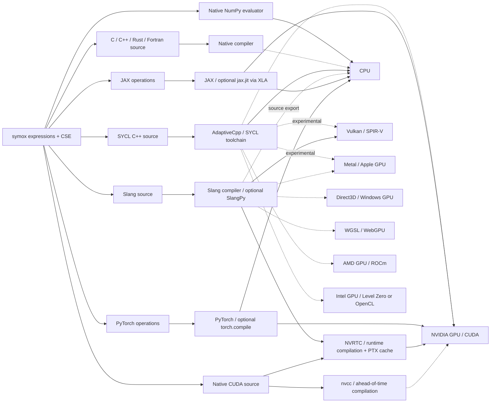

# Code generation targets

[README](../../README.md) · [Code generation](overview.md)

- [Native CUDA execution with NVRTC](cuda.md)
- [PyTorch code generation](pytorch.md)
- [JAX code generation](jax.md)
- [Slang code generation](slang.md)
- [SYCL and AdaptiveCpp code generation](sycl.md)
- [Symbolic code generation compatibility](compatibility.md)

Custom tensor and GPU APIs live in `symox.extra`, for example
`from symox.extra import torch_lambdify, jax_lambdify, slang_kernel, sycl_kernel`.
Their implementation modules are `symox.extra.codegen.*` and
`symox.extra.printing.*`. Importing them does not load execution libraries.
The SymPy entry points `lambdify(..., modules="jax")` and
`printing.pytorch.TorchPrinter` / `torch_code` remain available.

Install the optional execution libraries with `pip install 'symox[extra]'`.
See [the extension test environment](../testing.md) for CPU/GPU validation and
the pinned AdaptiveCpp SDK.

**symox aims to be the most complete symbolic engine for code generation across
heterogeneous targets.** One symbolic model feeds native code and array frameworks
across CPUs and GPUs. CUDA alone is reachable through native CUDA source compiled
with nvcc or NVRTC, PyTorch, JAX, Slang and SYCL:

Solid device edges are exercised by this project's numerical execution tests.
Dotted edges show external toolchain routes not
validated here; they are not guarantees of feature or precision parity.
JAX is tested on CPU and NVIDIA CUDA; GPU execution requires a suitable
JAX installation. Explicit JIT devices select the compiled executable's
placement, including when its inputs are Python scalars.
Native source exports need their corresponding compiler and host integration.
Native CUDA source can be compiled ahead of time with nvcc or at runtime with
NVRTC. `cuda_lambdify` supplies native NVRTC compilation and execution; raw
source exports can also be integrated by the caller. NVRTC is also used by
the SlangPy CUDA execution path.
SlangPy's CPU dispatch is not enabled by our adapter. AdaptiveCpp's tested
configuration is the CPU OpenMP backend; GPU execution needs a compiler/runtime
installation with those backends enabled. The diagram does not imply that
symox chooses a backend automatically or that every route has the same speed.

Framework functions preserve autograd where supported; Slang and SYCL exports
are ordinary direct numerical kernels and require no differentiation framework.
